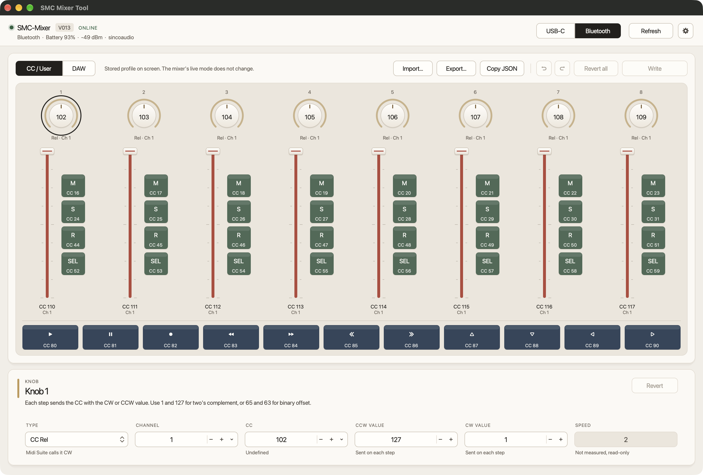

# SMC Mixer Tool

macOS app for the M-VAVE SMC-Mixer ([Wireless DAW Control Surface](https://www.m-vave.com/product?id=smc-mixer)). It reads the device identity and both stored profiles over USB-C or Bluetooth, edits the CC / User profile, and writes the changed records back.



## Download

[SMC Mixer Tool 1.0.3](https://github.com/deadjoe/SMC-Mixer-Tool/releases/tag/v1.0.3) is a universal macOS app for Apple silicon and Intel, on macOS 12 or later.

The app is not notarized. The first time you open it, Control-click SMC Mixer Tool and choose Open.

## Use

Connect the mixer with USB-C or Bluetooth and open the app. It finds the mixer on the link chosen at the top right, reads its identity, then reads a 6,282-byte settings image: the DAW profile, then the CC / User profile, 3,141 bytes each. The bar across the top says whether the mixer is online, what the app is doing, and what the link reports: the USB-C port, or battery and signal over Bluetooth. Refresh reads everything again.

The panel draws the mixer as it is laid out: eight channels of a knob over a fader and its Mute, Solo, Record, and Select keys, then the transport keys. Each control shows what is stored for it. A knob shows its CC number, its type, and its Min to Max range on the ring. A fader shows its range on the slot, and each key shows the CC, note, or program it sends. Click a control, or move between them with the arrow keys, to see all of its settings below. The panel only selects a control. It does not send performance MIDI.

CC / User and DAW, at the top left of the panel, choose which stored profile is on screen. The mixer's live mode stays where it is. The M-VAVE manual switches it by holding Shift and pressing Left or Right.

In the CC / User profile you can edit type, channel, CC, minimum, and maximum. Keys have a mode, value 1, value 2, and LED. Knob types are CC Abs, Aftertouch, Note, and CC Rel. Midi Suite calls CC Rel "CW". Field names follow the type or mode: a CC Rel knob has CW and CCW values, and a Program key has Bank MSB, Bank LSB, and Program. A field the mixer does not send is dimmed and marked not sent. The messages each type sends are listed below. Type a number, drag up or down on it, scroll, use the arrow keys, or step with − and +. The chevron beside Channel and CC lists every value, with the MIDI name of each CC. Min cannot pass Max, except on a CC Rel knob, whose two values are sent per step rather than a range. Leaving CC Rel swaps the two values if Min would end up above Max. Speed and LED are shown as stored; what they change has not been measured, so Speed is read-only.

A dot marks each control with an unsaved edit. Undo and Redo step through edits, and one drag counts as one step. Revert restores the selected control, and Revert all restores every control. Write sends only the records that changed, reads those addresses back and checks them, then tells the mixer to save to flash so the edits survive a power cycle. If any step fails, nothing is saved. The edits stay on screen so Write can try again, and switching the mixer off and on discards whatever reached it. USB-C carries the payload as SysEx on the Private port. Bluetooth sends the same payload on the vendor channel. The DAW profile is read-only. Quitting with unsaved edits, by the close button or Cmd+Q, asks first.

The mixer sends each control message on its USB-C Master port, its Private port, and over Bluetooth at the same time. In a host or instrument, turn on only one of these inputs, or every message arrives two or three times.

Export saves the profile on screen as JSON. Copy JSON puts that JSON on the clipboard. Channels in the file are numbered from 1.

| Shortcut | Action |
| --- | --- |
| Cmd+R | Refresh |
| Shift+Cmd+R | Read the settings again |
| Cmd+S | Write changes |
| Cmd+Z, Shift+Cmd+Z | Undo, Redo |
| Cmd+Delete | Revert the selected control |
| Cmd+1, Cmd+2 | Show CC / User, show DAW |
| Cmd+E | Export the profile as JSON |
| Shift+Cmd+C | Copy the profile as JSON |
| Shift+Cmd+D | Diagnostics |

The gear at the top right opens diagnostics. It reports the USB-C Private and Master ports, the Bluetooth MIDI port, which path carries settings, and the last error. A Bluetooth connection also lists manufacturer, model, battery, signal, and services. Read settings loads the 6,282-byte image, and Export image saves it.

Diagnostics and About SMC Mixer Tool show the version: `1.0.3` plus the git commit used for the build. A dirty worktree adds `.dirty`. The version itself is set once, in `project()` in CMakeLists.txt.

## MIDI each type sends

These were captured on the USB-C Master port with test values written to RAM only, and the original bytes were written back afterward. Value 1 and Value 2 were 17 and 34, so a fixed 0 or 127 could not pass for a stored value. `n` is the channel.

Knobs:

| Value | Type | Messages |
| --- | --- | --- |
| 0 | CC Abs | `Bn cc vv`, the value moving between Min and Max. Midi Suite calls it CC. |
| 1 | Aftertouch | `Dn vv`, channel pressure. No CC number is sent. |
| 2 | Note | Note On 104 plus the channel number on channel 1 while turning, velocity 127 then 0, and Pitch Bend `En 00 vv` on the knob's channel. This is a Mackie fader touch. No CC number is sent. |
| 3 | CC Rel | One `Bn cc vv` per step: Max clockwise, Min counter-clockwise. Midi Suite calls it CW. The DAW profile uses 1 and 65, Mackie's +1 and -1. |

Min and Max of a CC Rel knob are two values to send, not a range, so Min may be above Max.

Faders:

| Value | Type | Messages |
| --- | --- | --- |
| 0 | CC | `Bn cc vv` |
| 1 | Aftertouch | `Dn vv`, channel pressure. No CC number is sent. |
| 2 | DAW | Pitch Bend `En 00 vv`. The low byte is always 0. No CC number is sent. |

Buttons:

| Value | Mode | Messages |
| --- | --- | --- |
| 0 | CC Single | `Bn cc v1` on each press, nothing on release |
| 1 | CC Toggle | `Bn cc v2` and `Bn cc v1` on alternate presses |
| 2 | CC Push | `Bn cc v2` on press, `Bn cc v1` on release |
| 3 | Program | `Bn 00 cc`, `Bn 20 v1`, `Cn v2` on each press: Bank MSB, Bank LSB, Program |
| 4 | Custom | The stored message on each press, for example `F0 7F 7F 06 08 F7` |
| 5 | Note | `9n cc 7F` on press, `9n cc 00` on release. Value 1 and Value 2 are not sent. |

Not yet measured: what knob Speed does, whether Min and Max limit Note and Aftertouch knobs, and whether these types behave the same in DAW mode.

## Build

macOS 12 or later, CMake 3.22, and the Xcode command-line tools. CMake fetches JUCE 9.0.4, which keeps its own license. Each build signs the app bundle ad hoc, so macOS keeps one Bluetooth permission for it.

```
cmake -S . -B build
cmake --build build --target SMCMixerCoreTests SMCMixerUITests
./build/SMCMixerCoreTests
./build/SMCMixerUITests_artefacts/Debug/SMCMixerUITests
cmake --build build --target SMCMixerGUI
open "build/SMCMixerGUI_artefacts/Debug/SMC Mixer Tool.app"
```

The release download is a universal Release build:

```
cmake -S . -B build-release -DCMAKE_BUILD_TYPE=Release -DCMAKE_OSX_ARCHITECTURES="arm64;x86_64"
cmake --build build-release --target SMCMixerGUI
```

The core tests cover the vendor frames, acknowledgements, the snapshot layout, field limits and ranges, undo, the control descriptions, SysEx assembly, and the write sequence against a simulated mixer. They build with warnings as errors. The UI tests build the app's components without a window and never open a MIDI port or Bluetooth: they check the layout from the smallest window size up, the selection ring, the Min and Max editors, the status bar, the quit prompt, the commands, and text contrast. `SMCMixerUITests --render <folder>` also saves a PNG of each state. GitHub Actions runs both and builds the app on macOS for every pull request and every push to main.

## License

SMC Mixer Tool is free software under the GNU Affero General Public License, version 3. See [LICENSE](LICENSE). It is built on JUCE, which is offered under the AGPLv3 or a commercial licence, so the app and its source are distributed under the AGPLv3 to match. Releases up to 1.0.3 were published under the Apache License 2.0.
